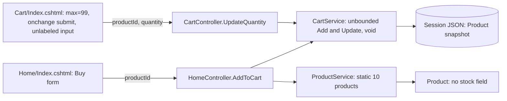
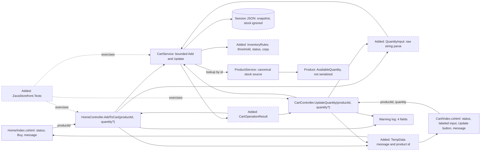
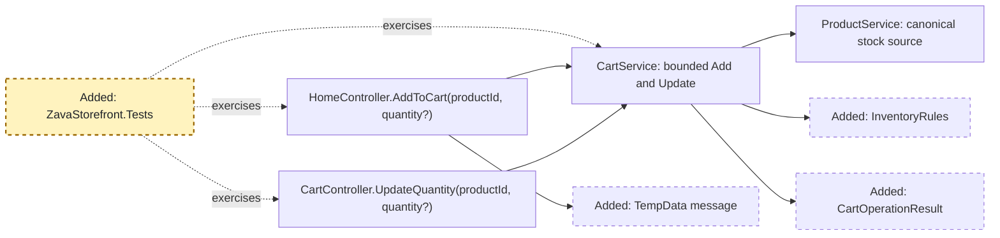
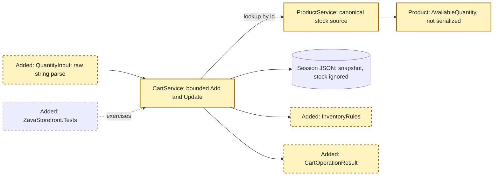
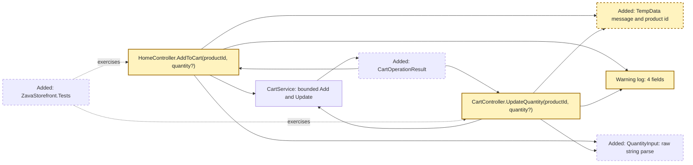
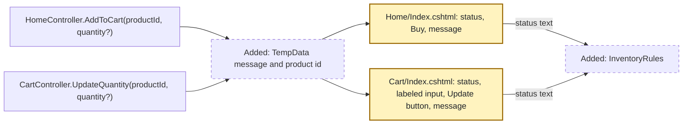
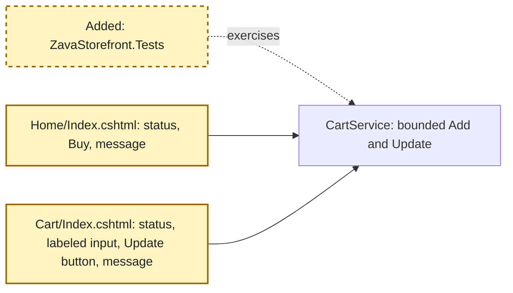

<!-- markdownlint-disable-file -->
# RPI Plan: Inventory-aware cart fix (code plan, local demo)

## Task Metadata

* Task ID: `inventory-aware-cart-fix` (squad run `init-2026-10-17-001`, topic `inventory-aware-cart`)
* Task slug: `inventory-aware-cart-fix`
* Plan date: 2026-10-18
* Binding output path: `.copilot-tracking/plans/2026-10-18-inventory-aware-cart-fix-plan.md` (flat, as directed by the caller)
* Supersedes nothing: [.copilot-tracking/plans/2026-10-17-inventory-aware-cart-plan.md](2026-10-17-inventory-aware-cart-plan.md) is documentation-scope history, not a code plan.
* Revision: 3 of the same code plan: revision 2 (corrected after the independent standard critique of revision 1 and aligned to the user-approved local-demo amendment A1) plus a bounded test-oracle correction (TC-B03, TC-B03m) and one decision interpretation (D8, RV-003) that follow the G5 review. No product behavior, scope, or approved user choice changed. Normative criteria are CAC-001 to CAC-030 of [.copilot-tracking/plans/2026-10-17-inventory-aware-cart-prd.md](2026-10-17-inventory-aware-cart-prd.md) (PRD v1.0 amended by A1).

## Executive Summary

* Bottom line: the storefront has no inventory concept. Nothing validates a quantity at add or update, and checkout does not revalidate (it clears the cart). The plan gives every `Product` an available quantity and applies one ordered rule (low stock is 1 to 5 inclusive, 0 is out of stock) to both the **Add** and **Update** paths. It shows the approved stock copy, rejects over-stock changes with the approved message, and keeps the last valid cart. Per A1, a negative, nonnumeric, overflowing, blank, or missing-on-Update quantity leaves the cart unchanged, announces `Enter a valid whole-number quantity of zero or more.`, and logs one safe structured warning. The plan adds the repository's first automated test project, plus real HTTP and browser verification.
* Why this matters: the user-selected target is 60% completed demo checkout confirmations against a 40% user-reported, unverified baseline. The 60% is a target, not a validated outcome promise. Finance measures about 3 months after deployment from existing aggregate data, not this code.
* Planning result: a five-phase, single-developer code plan with a minimal root-cause fix across mutation, display, session, logging, errors, and tests, using existing patterns. Every CAC maps to named test cases in the crosswalk.
* Confidence and uncertainty: high on the code path (continuous trace of every affected file). Quantity handling no longer relies on inferred MVC `int` binding: a raw-string parser is unit-tested and the real binding is proven by real HTTP posts and a real browser in P05.
* Readiness and critique status are recorded only in Planning Readiness and Critique Disposition, so this summary does not go stale.

### What You May Not Know

* `Add` takes no quantity today. The approved "Add quantity 0 removes the item" rule needs a new optional `quantity` parameter. An **omitted** field means 1 (the existing Buy form is unchanged); an **explicit blank** is invalid. MVC normalizes an empty string to `null`, so the plan tells the two apart by whether the `quantity` form key was posted.
* The session stores a full `Product` snapshot. Stock must always come from the **current** `ProductService.GetProductById` catalog, never from the session copy; an old session would otherwise read as 0 or stale stock.
* Today a missing or unparsable `quantity` on Update binds to 0 and **silently deletes the item**, and a negative Update removes it. A1 intentionally replaces both: explicit `0` is the only quantity that removes; every other invalid quantity leaves the cart unchanged with an announced message.
* The cart's `onchange="this.form.submit()"` conflicts with keyboard recovery and the quantity input has no label; both are fixed together.
* The Home page has no cart summary. CAC-017 ("near the cart summary") is satisfied on the Cart page by placing the message in the existing Order Summary region; on Home the message goes at the top of the page content, and no new summary feature is invented (a recorded interpretation, D9).
* There is no test project in source control (only ignored build leftovers). The developer owns creating and running tests.
* Docs claim 8 products (and `wwwroot/images`); the code has 10 with remote `ImageUrl`s. This is observed context, not new policy: catalog, prices, and images are not changed to match the docs.

## Phase Checklist

### Before



### After



Before: no stock data, nothing validates, controllers cannot see a failure, and a missing or unparsable quantity can delete a line. After: one rule class, one raw-string quantity parser, and one result type sit between the controllers and services; rejections travel by redirect plus `TempData` to the origin page; tests, real HTTP, and a real browser exercise all of it. Views and session shape are otherwise unchanged.

<!-- rpi:phase id=P01 -->
### [ ] P01: Test harness and behavior baseline

Goals:
* A runnable `net6.0` test project exists and pins today's unchanged behavior (remove, checkout, totals, catalog snapshot) before anything changes, so regressions are visible.

Dependencies:
* Pre-code gates G1 to G4 (see Dependencies).



Highlighted work: the new test project only.

<!-- rpi:task id=P01-T01 -->
#### [ ] P01-T01: Create the test project

Goals:
* `dotnet test tests/ZavaStorefront.Tests/ZavaStorefront.Tests.csproj` restores, builds, and runs.

Requirements:
* FR-012, NFR-004, NFR-005.
* Project path is exactly `tests/ZavaStorefront.Tests/ZavaStorefront.Tests.csproj`, `net6.0`, with a `ProjectReference` to `../../src/ZavaStorefront.csproj`. Packages limited to xunit, `Microsoft.NET.Test.Sdk`, `xunit.runner.visualstudio`, and (only if needed) NSubstitute and `coverlet.collector`.
* Write the manifest first, then restore from the public canonical feed or the cached packages. No Moq or MSTest. `Microsoft.AspNetCore.Mvc.Testing` is not planned (no cached net6.0 package, and `Program` has no public partial class); real binding is proven by real HTTP in P05-T01 instead. Add a package beyond the list above only after a demonstrated need, manifest first and confirmed to restore, never by a guessed install. Do not touch the stale ignored `bin`/`obj`, `src/ZavaStorefront.sln`, or add a csproj at the `tests/` root (it would glob the stale folders).
* Blocker exit: if restore fails from both the cached packages and the public feed, or `Microsoft.AspNetCore.App` 6.0.x is absent, P01 is Blocked. Stop and notify the parent (Squad Coordinator) with the exact failure. Do not switch test frameworks, retarget `net6.0`, or add any broader fallback.

Details:
* Cached versions seen by research: xunit 2.9.3, Test SDK 17.12.0, runner 2.8.2, NSubstitute 5.3.0, coverlet 6.0.2; use these unless restore requires otherwise. Building `net6.0` under SDK 10 emits NETSDK1138 (warning only). `Microsoft.AspNetCore.App` 6.0.36 is installed; confirm at start (research U7).
* Test helpers to build: an in-memory `ISession` fake with `DefaultHttpContext`/`IHttpContextAccessor`, a request helper that sets a real `application/x-www-form-urlencoded` form collection (so a test can post an absent `quantity` key, an empty one, or a value), and a small capturing `ILogger<T>` that records every entry (level, message, and structured state key/values; hand-rolled, because NSubstitute does not capture the generic `Log` call cleanly).
* Avoid new production interfaces. If a controlled catalog is truly needed, prefer `virtual` methods on `ProductService` (DI-safe) over a public constructor taking `IEnumerable<Product>`, which DI would resolve as an empty sequence. This is an option, not a requirement; tests may use the seeded catalog.

References:
* [src/ZavaStorefront.csproj](../../src/ZavaStorefront.csproj): `net6.0`, no package references.
* [.copilot-tracking/research/2026-10-18/inventory-aware-cart-code-research.md](../research/2026-10-18/inventory-aware-cart-code-research.md):
  * F7 and F10 under `## Findings`.

Dependencies:
* None

<!-- rpi:task id=P01-T02 -->
#### [ ] P01-T02: Characterize current behavior

Goals:
* Existing behavior the change must preserve is asserted by passing tests on unmodified `src`.

Requirements:
* FR-011, CAC-011, CAC-012, CAC-023, CAC-024 (baseline for TC-S16, TC-S17, TC-S29, TC-S30).
* Baseline tests pass on unmodified `src`: remove (known/unknown ID), checkout clears cart and redirects, empty-cart checkout, `GetCartTotal`, `GetCartItemCount`, and the catalog has 10 products with their current names, prices, and `ImageUrl`s (capture as a snapshot to guard P02).
* Do not assert today's `int` model-binding or today's missing-quantity deletion: A1 replaces those behaviors, and no fake legacy-binding pin is needed. Binding correctness is proven by the raw-string parser unit tests (P02-T01) and by real HTTP and browser posts (P05-T01).

Details:
* Controllers are instantiated with the fake session, capturing logger, and `TempData` dictionary from P01-T01. Update on an absent item or unknown ID is a no-op on cart state today; keep a cart-state-only baseline, because P03 adds an announced message for an unknown ID without mutating anything.

References:
* [src/Controllers/CartController.cs](../../src/Controllers/CartController.cs), [src/Controllers/HomeController.cs](../../src/Controllers/HomeController.cs), [src/Services/CartService.cs](../../src/Services/CartService.cs).

Dependencies:
* P01-T01

<!-- rpi:phase id=P02 -->
### [ ] P02: Inventory data, rule, and service semantics

Goals:
* One canonical stock source and one shared rule drive Add and Update identically, with a result the controllers can act on. This is the root-cause fix.

Dependencies:
* P01



Highlighted work: `Product`, `ProductService`, `CartService`, `InventoryRules`, `QuantityInput`, `CartOperationResult`.

<!-- rpi:task id=P02-T01 -->
#### [ ] P02-T01: Stock data, shared rule, quantity parser, and result type

Goals:
* Every product has an available quantity from `ProductService`, status and copy come from one pure place, and a posted quantity string is parsed into a distinct omitted, valid, or invalid input without any parse failure becoming `0`.

Requirements:
* FR-001, FR-002, FR-003, FR-005, FR-007, FR-008, FR-011, NFR-003; CAC-010, CAC-011, CAC-012, CAC-018, CAC-020, CAC-025 to CAC-029.
* Add an `AvailableQuantity` property to `Product`, excluded from session JSON (`[JsonIgnore]`) so no snapshot can carry stock. Keep the public parameterless constructor and settable properties.
* Seed all 10 products (Ids 1 to 10) with synthetic demo values covering 0, 1, 5, and 6 plus at least one comfortably above 6. Label them seed data, not warehouse evidence. Names, descriptions, `Price`, and `ImageUrl` are unchanged.
* Add one pure `InventoryRules` (static class or equivalent) holding the threshold constant 5, status for an available quantity (0 or unknown product is out of stock; 1 to 5 inclusive is low; above 5 is in stock), and the five approved strings exactly:

```text
In-stock
Only {availableQuantity} left
Out of stock
Stock unavailable. Available quantity: {availableQuantity}. Reduce the quantity.
Enter a valid whole-number quantity of zero or more.
```

(The five strings above are the approved copy contract. `Out of stock` is also the message for a positive request at stock 0 and for an invalid product ID; the overstock template is only for a valid positive quantity above a positive availability; the last string is the A1 invalid-quantity message.)
* Add one pure raw-string parser, `QuantityInput` (name illustrative), taking the posted `string?` and whether the `quantity` form key was supplied, and returning exactly one of the following (this is the contract; the member names are illustrative):
  * `Omitted`: key not posted.
  * `Valid(n)`: `n >= 0`, from `int.TryParse(value, NumberStyles.Integer, CultureInfo.InvariantCulture, out n)`.
  * `Invalid(requestedQty)`: key posted but null, empty, whitespace, or not parseable (`requestedQty` null); an overflowing value (null, never a fabricated number); or a negative value (`requestedQty` is that safe negative integer).
* A parse failure is never returned as `Valid(0)`. `Omitted` means 1 only for Add; for Update it is invalid (null `requestedQty`).
* Add one small result type (for example `CartOperationResult`: outcome enum of succeeded, removed, no-op, out of stock, over limit, invalid quantity; the available quantity as a nullable int; the submitted quantity as a nullable int) as the only new service-facing abstraction.

Details:
* Unknown product ID resolves to no availability (displayed and enforced as 0) via the same `GetProductById` path; a single lookup path only. Illustrative seed pattern: Id1=0, Id2=1, Id3=5, Id4=6, the rest 8 to 25. The developer may choose other values that keep every boundary covered.
* The posted value of an explicit blank is not distinguishable from an omitted key by MVC string binding (empty string becomes `null`), which is why the parser takes the key-presence flag, set by the controller (P03-T01).
* No Razor-resident business rules; no config file, no interface unless a test genuinely requires it.
* Cases authored here: TC-P01 to TC-P09, TC-S14 to TC-S18 (see the Acceptance Crosswalk and Test Case Catalogue).

References:
* [src/Models/Product.cs](../../src/Models/Product.cs), [src/Services/ProductService.cs](../../src/Services/ProductService.cs), [src/Models/CartItem.cs](../../src/Models/CartItem.cs).
* [.copilot-tracking/squad/decisions.md](../squad/decisions.md): UQ-007 to UQ-012 in the 2026-10-18 local demo approval entry.

Dependencies:
* P01-T01

<!-- rpi:task id=P02-T02 -->
#### [ ] P02-T02: Ordered, bounded Add and Update in `CartService`

Goals:
* Add and Update enforce the same inclusive limit through one ordered rule and return a result; every rejection or invalid quantity leaves the cart untouched.

Requirements:
* FR-003, FR-004, FR-005, FR-006, FR-007, FR-008, FR-011; CAC-001 to CAC-009, CAC-018, CAC-019, CAC-022, CAC-025 to CAC-029.
* Service shape (illustrative): `AddToCart(int productId, QuantityInput quantity)` and `UpdateQuantity(int productId, QuantityInput quantity)`, each returning `CartOperationResult`. Each applies the following ordered rule and stops at the first matching step (the order is a PROPOSED engineering choice, D8; the PRD defines no simultaneous-fault precedence):
  1. Unknown product ID (null from `GetProductById`, including 0 and negative): outcome out of stock, no mutation.
  2. Invalid quantity (`Invalid`, from a negative, nonnumeric, overflowing, blank, or missing-on-Update value): outcome invalid quantity, cart unchanged. A negative Update never removes.
  3. Add only: `Omitted` becomes 1.
  4. Update only: the product has no line in the cart: silent no-op (preserved behavior; no message, no warning).
  5. Explicit `0`: remove the existing line on either path; no-op when absent. This step does not depend on stock.
  6. Positive quantity with availability 0: outcome out of stock, cart unchanged (a stale line stays; only explicit 0 removes it).
  7. Over limit: Add where existing line plus submitted exceeds available, or Update where the submitted quantity exceeds available: outcome over limit, cart unchanged. Compute in `long` so `int.MaxValue` cannot wrap.
  8. Otherwise store: Add stores the cumulative total; Update stores the absolute value.
* No stored quantity can exceed available through Add or Update. Availability is read from the current `ProductService` catalog on every call, never from the session snapshot.
* Reuse the existing remove branch via a private helper. A successful Add or Update neither reserves nor decrements stock (`AvailableQuantity` is never mutated).

Details:
* Cases authored here: TC-S01 to TC-S13, TC-S19 to TC-S30, with Add and Update reported as separate rows (TC-xx-a, TC-xx-u). Use the real seeded catalog unless a controlled catalog is added (D6). Each ordered-rule step has its own test, and each adjacent pair that could conflict has a test (TC-S25).

References:
* [src/Services/CartService.cs](../../src/Services/CartService.cs).
* [.copilot-tracking/research/2026-10-18/inventory-aware-cart-code-research.md](../research/2026-10-18/inventory-aware-cart-code-research.md): F3, F5, F6, F9.

Dependencies:
* P02-T01

<!-- rpi:phase id=P03 -->
### [ ] P03: Controllers, input handling, messages, and logging

Goals:
* HTTP actions turn service results into the approved user outcome, keep the user on the origin page with the last valid cart, and log only the four approved fields.

Dependencies:
* P02



Highlighted work: both controller actions, the message carrier, and the single structured warning.

<!-- rpi:task id=P03-T01 -->
#### [ ] P03-T01: Quantity binding, rejection flow, and structured warning

Goals:
* Every rejection or invalid quantity redirects to the originating page carrying the exact approved message; invalid input never mutates the cart; each rejection logs exactly one safe structured warning and no log holds cart, session, customer, or raw input data.

Requirements:
* FR-003, FR-005, FR-007, FR-008, FR-009, NFR-001; CAC-006 to CAC-009, CAC-015, CAC-018, CAC-019, CAC-021, CAC-025 to CAC-030.
* Both actions bind `string? quantity` (not `int?`) with `int productId`, and build the `QuantityInput` (P02-T01) from the raw string and a supplied flag set from `Request.HasFormContentType && Request.Form.ContainsKey("quantity")`. Omitted Add means 1; an explicit blank is invalid and is never defaulted, never `0` (D7).
* Redirect to the origin (`Home` for Add, `Cart` for Update) after a rejection, carrying `TempData` with the exact message text from `InventoryRules` and the product ID (nullable) so the view can associate it. Message by outcome: out of stock gives `Out of stock`; over limit gives the overstock template with the actual available quantity; invalid quantity gives `Enter a valid whole-number quantity of zero or more.` Succeeded, removed, and the silent absent-line no-op carry no message and no warning.
* Exactly one warning per rejection (out of stock, over limit, invalid quantity), one structured template with only these four named properties, all numeric or nullable and never raw input (D10, D11). This is a contract for the property names and types; the wording is illustrative:

```text
LogWarning("Inventory request rejected: operation {Operation}, product {ProductId}, requested {RequestedQty}, available {AvailableQty}", ...)
Operation    int?  numeric code of a closed set (PROPOSED: 1 = add, 2 = update)
ProductId    int
RequestedQty int?  the submitted safe integer (a negative value is that number); null when blank, nonnumeric, overflowing, or missing
AvailableQty int?  current catalog availability; null when the product is unknown
```

* Existing logs are replaced, not stacked, so one failure produces one warning: replace the `HomeController` non-existent-product warning (current line 39) with the single structured warning; replace the `CartController` `LogInformation("Updating product {ProductId} quantity to {Quantity}", ...)` (current line 28), which would log the raw string, with an entry carrying only `{ProductId}`. Keep the existing `AddToCart` information log (it logs the catalog product name, not input).
* `RequestedQty` is the submitted quantity only, never the cumulative total, because the cumulative total would disclose cart contents.
* Preserve the prior cart on every rejection.

Details:
* `TempData` uses the default cookie provider; it needs no new configuration and survives the redirect, and a refresh does not resubmit. Controller tests use `TempDataDictionary` and a `DefaultHttpContext` with a real form collection, and the capturing logger records all entries at every level. Cases authored here: TC-C01 to TC-C11. Real model binding of `productId` and the string `quantity` is proven by real HTTP in P05-T01 (TC-H01 to TC-H15), not assumed. `GetCartCount` stays untouched (out of scope, research U8).

References:
* [src/Controllers/HomeController.cs](../../src/Controllers/HomeController.cs), [src/Controllers/CartController.cs](../../src/Controllers/CartController.cs).
* [.copilot-tracking/research/2026-10-18/inventory-aware-cart-code-research.md](../research/2026-10-18/inventory-aware-cart-code-research.md): F5, F8 message-survival table.

Dependencies:
* P02-T02

<!-- rpi:phase id=P04 -->
### [ ] P04: Display and accessibility

Goals:
* Shoppers see stock before committing and hear or see rejections in context, operable by keyboard and screen reader.

Dependencies:
* P03



Highlighted work: both views and `site.css`.

<!-- rpi:task id=P04-T01 -->
#### [ ] P04-T01: Stock status, announced message, and accessible cart controls

Goals:
* Home and Cart show approved status text per product from the current catalog; every rejection and invalid-quantity message is announced and focusable near the summary context; the cart quantity control is labeled and keyboard-safe.

Requirements:
* FR-002, FR-005, FR-010, NFR-002; CAC-010, CAC-013 to CAC-017, CAC-019, CAC-020.
* Status text: every Home card and every Cart row shows the approved status (counts only for low stock) as visible text, which is the primary cue. Cart availability comes from a controller-supplied catalog availability map (or `ProductService`), never the session snapshot. Home `Buy` is `disabled` for availability 0 as a convenience only; a disabled button cannot take focus, so no announcement depends on it, and the server still enforces for forged posts.
* Cart controls: a labeled quantity input whose accessible name includes the product (a `<label>` or `aria-label`); remove `onchange="this.form.submit()"` and use an explicit Update button per row; drop the client `min`/`max` constraints and put `novalidate` on the Update form, so the server's approved message is the single message for negative, blank, or nonnumeric input; use `inputmode="numeric"`.
* Message region: one server-rendered container with `role="alert"` and `tabindex="-1"` holding the `TempData` text. Because an alert present at page load is not reliably announced, the single pinned focus mechanism is: when a message exists, focus moves to that container on page load (a small script calling `focus()`), and tab order continues from there. Do not move focus to a disabled `Buy`.
* Placement (CAC-017, D9): on the Cart page the region sits inside the existing Order Summary card column. When the cart is empty (no Order Summary renders) it sits above the empty-state alert. On Home there is no cart summary and none is added; the region sits at the top of the page content directly under the header (the header cart badge is the nearest existing cart indicator). A message with no matching card (invalid product ID) uses the same page-level region.
* Association: when the message's product ID matches a Cart row, that row's quantity input has `aria-describedby` referencing the region (plus its status id). On Home the matching card's `Buy` has `aria-describedby` referencing its status text, and the region when the message is for that product.
* Status never depends on color alone (text plus, optionally, a CSS modifier in `site.css`). Works at 1024 CSS px and keeps existing responsive behavior at engineering-chosen representative widths (for example 1024, 768, 375), labelled as test inputs, not a supported-device standard.

Details:
* Razor formats strings from `InventoryRules` only; no thresholds in views. Existing `alert` Bootstrap markup is the model. The cart badge name and anti-forgery tokens are pre-existing and out of scope. Real browser and HTTP checks for this task are cases TC-B01 to TC-B09 in P05-T01.

References:
* [src/Views/Home/Index.cshtml](../../src/Views/Home/Index.cshtml), [src/Views/Cart/Index.cshtml](../../src/Views/Cart/Index.cshtml), [src/wwwroot/css/site.css](../../src/wwwroot/css/site.css).
* [.copilot-tracking/research/2026-10-18/inventory-aware-cart-code-research.md](../research/2026-10-18/inventory-aware-cart-code-research.md): F8 accessibility gaps.

Dependencies:
* P03-T01

<!-- rpi:phase id=P05 -->
### [ ] P05: Verification and records

Goals:
* The change is proven end to end, documented, and journaled, ready for the independent tester review.

Dependencies:
* P04



Highlighted work: full test run, real HTTP and real browser case verification, README, and the changes record.

<!-- rpi:task id=P05-T01 -->
#### [ ] P05-T01: Full test run, real HTTP, and real browser verification

Goals:
* All automated tests pass, and the real request binding, session state, Razor output, announcement, and keyboard behavior are observed running, case by case.

Requirements:
* FR-003, FR-005, FR-007, FR-008, FR-009, FR-010, FR-011, FR-012, NFR-001, NFR-002, NFR-004, NFR-005; CAC-001 to CAC-030 per the crosswalk.
* `dotnet build src/ZavaStorefront.csproj --nologo` and `dotnet test tests/ZavaStorefront.Tests/ZavaStorefront.Tests.csproj --nologo` pass, including the regression tests for remove, checkout clear, totals, and badge count.
* Real HTTP (TC-H01 to TC-H15): with the app running as a temporary attached local server (stopped afterward), send real form-encoded `POST` requests with a cookie-jar session, to Add and Update, for each A1 input (omitted key, explicit blank, `-1`, `abc`, `2147483648`, `0`), overstock, stock 0, and unknown ID. Read the cart back with `GET /Cart` to prove it is unchanged, and prove the exact message appears once and is gone on a second `GET` (TempData consumed, no resubmit). Capture the server console log and confirm one warning with the four properties and no raw input. These posts are the proof of real MVC binding; record the observed binding results in the changes record.
* Real browser (TC-B01 to TC-B09, plus TC-B03m): use Playwright (or equivalent real browser), keyboard only: `Tab`, `Enter`, `Space`; no auto-submit; after a rejection assert `document.activeElement` is the alert region, the alert role and text appear in the accessibility snapshot, the affected input's `aria-describedby` resolves to it, and a disabled `Buy` never receives focus. Check Home and Cart placement per D9, status text understandable without color, and layout at the representative widths.
* Report every case ID as pass, fail, or not run with its evidence; a case that is not run is stated, never implied as passed. External image URLs are only displayed, never modified.

Details:
* Posts without an anti-forgery token are accepted today (pre-existing, out of scope). No automated accessibility tool exists in the repo, and no real screen reader is run: announcement is verified by role, text, focus, and the accessibility snapshot, which is a residual limit recorded in the changes record. Reading the live Home HTML and console is enough for TC-H14 and TC-H15; no extra tooling is introduced.

References:
* [.copilot-tracking/research/2026-10-18/inventory-aware-cart-code-research.md](../research/2026-10-18/inventory-aware-cart-code-research.md): `Verification commands` under `## Planning Readiness and Next Step`.

Dependencies:
* P04-T01

<!-- rpi:task id=P05-T02 -->
#### [ ] P05-T02: README and changes record

Goals:
* The behavior is documented and every change, deviation, and observed result is journaled.

Requirements:
* FR-011, NFR-005.
* `src/README.md` gains a short inventory behavior note (rule, copy, seed-data label, A1 invalid-quantity behavior). Do not edit its 8-product claim; record the docs-versus-code discrepancy as observed context in the changes record.
* Create `.copilot-tracking/changes/2026-10-18-inventory-aware-cart-fix-changes.md` (proposed path) with changed files, per-case results for every TC id, binding observations from P05-T01, and decisions D1 to D11 as built.
* No Git commits, pushes, deploys, Jira, or Confluence writes; no edits to the PRD, source decisions, or squad state.

Details:
* Leave the working tree for the parent's gated hand-off.

References:
* [src/README.md](../../src/README.md).

Dependencies:
* P05-T01

## User Decisions and Requirements

### Confirmed User Direction

* Scope exactly as the local-demo packet (v1.0, 2026-10-18T08:38:58Z) in [.copilot-tracking/squad/decisions.md](../squad/decisions.md), with the correction note keeping the baseline at exactly "about 40%, user-reported".
* Approved local-demo amendment A1, source [.copilot-tracking/squad/decisions.md](../squad/decisions.md#2026-10-18t105056z-localdemoamendmenta1-inventory-aware-cart-invalid-quantity-behavior) (user-approved 2026-10-18T10:50:56Z): omitted Add quantity defaults to 1; explicit `0` removes on Add and Update; a negative, nonnumeric, or overflowing quantity on either path, and a missing Update quantity, leaves the cart unchanged, announces exactly `Enter a valid whole-number quantity of zero or more.`, and logs a safe structured warning (four fields, numeric or nullable only, never raw input, session, cart, or customer data). This intentionally replaces negative-Update removal. It overrides the critique's advice that negative Add be a silent no-op with no log (PC-003) and that malformed input be a silent accepted risk (PC-009).
* Target 60% (user-selected, not a validated promise); Finance aggregates existing data; review 3 months after deployment; no app analytics or identifiers.
* Display counts only for low stock 1 to 5 inclusive; 0 is out of stock; above 5 is in stock. Exact counts are allowed in an inventory-limit rejection.
* Approved copy is exactly the five strings in P02-T01. `Out of stock` covers stock 0 and an invalid product ID; the overstock template covers only a valid positive quantity above a positive availability.
* Inclusive, cumulative rule on both paths; rejection preserves the cart and stays on the origin page; zero availability cannot be bought.
* Preserve all 10 products, prices, `ImageUrl`s; do not alter the catalog to match the 8-product docs.
* Static catalog and session only: no DB, reservation, decrement, payment, warehouse, or new analytics.
* Accessibility, structured four-field warning, desktop 1024 CSS px, local-demo Jira waiver, no commits, pushes, or deploys.
* Minimal root fix with existing patterns; developer owns code and test execution.
* Council before code: System Architecture Reviewer and Functional Planner (bounded architecture and product-fit review only). No unused security, cost, or RAI roles unless evidence signals need. Under user autopilot, the coordinator admission gate (G4) needs no extra human confirmation unless a new risk or impact appears.

### Planning Decisions and Feedback

Rows marked approved trace to a user answer or the approved packet. Rows marked PROPOSED are engineering choices (agent-owned), justified in the row but not stakeholder-confirmed; the council and the tester review may challenge them.

| Group | Decision or feedback item | Status | Owner | Rationale or input needed | Evidence | Planning impact |
|-------|---------------------------|--------|-------|---------------------------|----------|-----------------|
| D1 | Message survival: PRG plus `TempData` (cookie provider), not re-render | PROPOSED (agent-owned) | agent | Keeps existing redirect semantics, no resubmit on refresh, no new config | Research F8 | P03-T01, P04-T01 |
| D2 | New abstractions limited to `InventoryRules`, `QuantityInput`, and one result type; no interface or config | PROPOSED (agent-owned) | agent | Controllers cannot see rejection from `void`; the rule and parser must live outside Razor and be unit-testable | Research F4, F9 | P02-T01 |
| D3 | `Product.AvailableQuantity` is `[JsonIgnore]` and never read from the snapshot; availability is always the current catalog | PROPOSED (agent-owned) | agent | Prevents stale or zero stock from old sessions; the serializer is `System.Text.Json` | Research F6 | P02-T01, P02-T02, P04-T01 |
| D4 | Invalid-quantity behavior: omitted Add = 1; explicit 0 removes; negative, nonnumeric, overflow, blank, and missing Update leave the cart unchanged with the announced A1 message and one safe warning | approved (user A1) | user | A1 replaces the earlier negative-removal and silent-no-op proposals | A1 anchor; CAC-025 to CAC-030 | P02-T02, P03-T01, P04-T01 |
| D5 | `Out of stock` for a positive request at stock 0 and for any invalid product ID; the overstock template only for a valid positive quantity above a positive availability | approved (UQ-009, CAC-007, CAC-018, CAC-019) | user | The approved packet fixes both copies; the rejection template is not used for zero stock | PRD CAC-007, CAC-018, CAC-019 | P02-T01, P02-T02, P03-T01 |
| D6 | Testability: seeded catalog by default; `virtual` over a public constructor only if needed | PROPOSED (agent-owned) | agent | DI trap with an `IEnumerable<Product>` constructor | Research F7 | P01-T01 |
| D7 | Quantity parsing: bind `string? quantity`, build a pure `QuantityInput` with `int.TryParse(NumberStyles.Integer, InvariantCulture)`, and take omitted-versus-blank from `Request.Form.ContainsKey("quantity")` | PROPOSED (agent-owned) | agent | Minimal reliable approach: MVC maps an empty string to `null`, and `int` or `int?` binding cannot tell omitted, blank, and malformed apart; a parse failure is never `0`. Real binding is proven by real HTTP, not assumed | Research F10 (no `Mvc.Testing`); A1 | P02-T01, P03-T01, P05-T01 |
| D8 | Ordered rule: unknown ID, invalid quantity, Add default, Update absent-line no-op, explicit 0, stock 0, over limit, store | PROPOSED (agent-owned) | agent | The PRD invents no simultaneous-fault precedence; this order keeps CAC-007 unconditional, removal independent of stock, and preserved no-op behavior for an absent Update line. Revision 3 interpretation (RV-003, planner-owned, challengeable, not new user authority): an Update for a product with no cart line has no resource to update and attempts no mutation, so FR-011's preserved silent no-op stands and CAC-018's overstock text applies to rejected mutations of an existing line or an Add; no code change, and TC-S25 and TC-C09 stay as written | PRD edge-case traces (each case isolated); FR-011 | P02-T02 |
| D9 | Message placement: inside the Order Summary on Cart (page-level above the empty state); top of page content on Home, where no cart summary exists and none is added; focus on the `tabindex="-1"` alert container on load | PROPOSED (agent-owned) | agent | CAC-017 reads "near the cart summary within the originating page context"; Home has no summary. The focusable container is announced reliably, unlike a page-load `role="alert"` alone | PRD CAC-014 to CAC-017 | P04-T01, P05-T01 |
| D10 | Warning `Operation` is a numeric code from a closed set (PROPOSED: 1 = add, 2 = update) | PROPOSED (agent-owned) | agent | CAC-030 requires numeric or nullable values for `operation` too and prescribes no mapping; the same template serves every rejection | PRD CAC-030, CNFR-005 | P03-T01 |
| D11 | One warning per rejection; existing `HomeController` non-existent-product warning and the `CartController` raw-quantity information log are replaced; `RequestedQty` is the submitted value only | PROPOSED (agent-owned) | agent | One failure yields one four-field warning; a cumulative total would disclose cart contents; the raw string must never be logged | PRD CAC-021, CAC-030 | P03-T01 |

## Planning Readiness and Next Step

| Field | Record |
|-------|--------|
| Planning execution and readiness | Planning execution complete: revision 2 finalized. G2 satisfied: the fresh full independent closure assessment of this revision is Complete/PASS with PC-001 to PC-012 closed and no blocking issues. Readiness for implementation: pending G3 council bounded reviews (next) and G4 coordinator code admission. Implementation must not start earlier. |
| Decision participation | agent-owned (parent-directed; no open human business decision for the local demo; the A1 amendment is user-approved). D1 to D11 recorded; D4 and D5 approved, the rest PROPOSED with rationale |
| Blockers | None for planning. Named gaps (Finance verification, mobile standard, truncated source bullet, deferred PRD intake cautions) are accepted non-blocking. |
| Latest critique | Revision 1 initial critique (Complete, Revise): `.copilot-tracking/reviews/2026-10-18-inventory-aware-cart-fix-plan-critique.md`. Revision 2 fresh full closure (Complete, PASS): attempt `inv-cart-fix-closure-full-20261018-1357`, `.copilot-tracking/reviews/2026-10-18-inventory-aware-cart-fix-plan-closure.md`; PC-001 to PC-012 all closed, no blocking issues, PRD content fidelity satisfied. |
| Relevant research | [.copilot-tracking/research/2026-10-18/inventory-aware-cart-code-research.md](../research/2026-10-18/inventory-aware-cart-code-research.md) |
| Plan | `.copilot-tracking/plans/2026-10-18-inventory-aware-cart-fix-plan.md` |
| Changes-record role | `.copilot-tracking/changes/2026-10-18-inventory-aware-cart-fix-changes.md` is implementation evidence |
| Continuation owner | Squad Coordinator (parent) |
| Required gates or confirmations | G1 PRD v1.0 plus A1: written and formally validated (`APPROVED_WITH_COMMENTS`, 0 blocking). G2 fresh full revision-bound critique, standard depth: satisfied (Complete/PASS, closure path above). G3 council bounded reviews (architect, product-owner): next, prerequisite artifacts. G4 coordinator code admission after G2 and G3: pending. G5 tester final review: after implementation. |
| Next action | G5 retest: rerun the browser keyboard cases under the revision 3 TC-B03/TC-B03m oracle (canonical hash `e8faea492df9c092200c7c95bffb60370ceba2ddb850ebd4fd9cb782ff19d9f7`), with no code change unless a real recoverability defect appears; then FINAL tester closure covering this hash. Revision 2 history: council next, hash `696e58e6d90e3fa4298b427232a0043a4c759b95140099372402464441e469e8` (now superseded). |

## Goals

* Prevent shoppers from adding or setting a cart quantity above available stock, on both paths, and show availability up front, in support of the user-selected 60% completed demo checkout target (a target, not a validated outcome).
* Handle every invalid quantity per A1: unchanged cart, announced exact message, safe structured warning.
* Deliver it as a minimal, tested, accessible local-demo change.

## Scope and Non-Goals

### In Scope

* `Product`, `ProductService`, `CartService`, both controllers, both views, `site.css`, the new test project, `src/README.md`, and the changes record.

### Non-Goals

* Catalog, price, or image changes; the 8-versus-10 docs fix; DB, reservation, decrement, payment, warehouse, new analytics or identifiers; checkout revalidation; cart badge accessible name, anti-forgery, and `GetCartCount` routing (pre-existing); Jira, Confluence, Git commit, push, or deploy; PRD, decision, or squad state edits; a new catalog or Home cart-summary feature; new product requirements, goals, or NFR targets (the PRD's deferred intake cautions and supporting SMART goal formulation belong to the PRD owner).

## Functional Requirements

* FR-001: Each of the 10 products has an available quantity supplied by `ProductService` (synthetic seed values covering 0, 1, 5, 6); prices and images unchanged.
* FR-002: Displayed status: above 5 `In-stock`; 1 to 5 `Only {availableQuantity} left`; 0 `Out of stock`. Counts appear only for low stock.
* FR-003: Add accepts an optional `quantity`. An omitted field means 1; an explicit blank is invalid. For a valid positive quantity, existing plus requested must not exceed available (inclusive, cumulative).
* FR-004: Update to a valid positive quantity above available is rejected (inclusive, absolute).
* FR-005: Messages are exact: a valid positive quantity above a positive availability shows `Stock unavailable. Available quantity: {availableQuantity}. Reduce the quantity.`; a positive request at stock 0 shows `Out of stock`; an invalid quantity shows `Enter a valid whole-number quantity of zero or more.`. Every rejection preserves the last valid cart, stays on the origin page, and is announced.
* FR-006: Explicit `0` removes an existing item on Add and Update (no-op if absent); zero availability can never be bought.
* FR-007: An invalid product ID shows `Out of stock`, mutates nothing, and exposes no internal error.
* FR-008: A negative, nonnumeric, overflowing, or blank quantity on either path, and a missing Update quantity, leaves the cart unchanged with the A1 message and a safe warning. A parse failure is never `0`. A negative Update never removes. Large valid values cannot wrap.
* FR-009: Each rejection or invalid quantity logs exactly one structured warning containing only `productId`, `requestedQty`, `availableQty`, and `operation`, with numeric or nullable values and never raw input.
* FR-010: Stock status and every message are programmatically available (text, association, announcement) and keyboard recovery works; the auto-submit conflict and unlabeled input are fixed together.
* FR-011: Remove, checkout clear, totals, badge count, and the silent absent-line Update no-op, and session cart shape remain unchanged. No add or checkout reserves or decrements stock.
* FR-012: A test project at `tests/ZavaStorefront.Tests/ZavaStorefront.Tests.csproj` covers service, parser, controllers, stale session stock, boundaries, rejection state, log payloads, and regressions, and real HTTP and browser checks cover binding and accessibility, each as independently reportable cases.

## Non-Functional Requirements

* NFR-001: Logs and messages contain no cart, session, customer, or raw untrusted string data.
  * Objective threshold or evaluation condition: every captured log entry at every level contains no raw input text, and each rejection yields exactly one warning whose state has exactly the four approved properties.
* NFR-002: Usable at 1024 CSS px, with existing responsiveness at engineering-chosen representative widths.
  * Operating condition or verification approach, if needed: P05 browser cases; widths labelled as test inputs, not a device standard.
* NFR-003: No new infrastructure: static catalog, session cart, no DB, config, or analytics.
* NFR-004: `dotnet build` and `dotnet test` pass on `net6.0` from a clean checkout.
* NFR-005: Local demo only: no Jira, Confluence, Git commits, pushes, or deploys; no PRD, decision, or squad-state edits.

## Acceptance Crosswalk and Test Case Catalogue

Normative criteria are CAC-001 to CAC-030 in [.copilot-tracking/plans/2026-10-17-inventory-aware-cart-prd.md](2026-10-17-inventory-aware-cart-prd.md) (PRD v1.0 amended by A1). The catalogue splits each criterion into independently reportable cases (path, input, expected outcome, level). Levels: `Par` pure parser unit; `Svc` service unit; `Ctl` controller unit with a real form collection and a capturing logger; `Http` real requests to the running app; `Brw` real browser. Where a case covers Add and Update, it is reported as two rows, `-a` and `-u` (for example TC-S10-a, TC-S10-u). Case ids are the reporting keys for the changes record and the tester review.

### Test case catalogue

| ID | Level | Path and input | Expected outcome |
|----|-------|----------------|------------------|
| TC-P01 | Par | Add, `quantity` key not posted | `Omitted` (becomes 1) |
| TC-P02 | Par | Add, key posted blank or whitespace | `Invalid`, `requestedQty` null; not defaulted, not 0 |
| TC-P03 | Par | Update, key not posted | `Invalid`, null |
| TC-P04 | Par | Update, key posted blank | `Invalid`, null |
| TC-P05 | Par | `-1` | `Invalid`, `requestedQty` -1 |
| TC-P06 | Par | `abc`, `3.5`, `1e2` | `Invalid`, null |
| TC-P07 | Par | `2147483648`, `-2147483649` | `Invalid`, null; no fabricated number |
| TC-P08 | Par | `0`, ` 3 `, `2147483647` | `Valid(0)`, `Valid(3)`, `Valid(2147483647)` |
| TC-P09 | Par | every input of TC-P02 to TC-P07 | none returns `Valid(0)` |
| TC-S01 | Svc | Add, stock 5, empty cart, quantity 5 | accepted; line quantity 5 |
| TC-S02 | Svc | Add, stock 5, line 3, add 3 | over limit; line stays 3 |
| TC-S03 | Svc | Add 1 when the line equals stock | over limit; cart unchanged |
| TC-S04 | Svc | Update to exactly stock | accepted |
| TC-S05 | Svc | Update to stock + 1 | over limit; prior quantity kept |
| TC-S06 | Svc | a rejected Add and a rejected Update on a multi-line cart | every line and order identical |
| TC-S07 | Svc | Add, product ID 0, -1, 999 | out of stock; cart unchanged |
| TC-S08 | Svc | Update, product ID 0, -1, 999 | out of stock; cart unchanged |
| TC-S09 | Svc | TC-S07 and TC-S08 | no exception; only `InventoryRules` text is exposed |
| TC-S10 | Svc | Add `Valid(0)`, line present, then absent | line removed; absent is a no-op |
| TC-S11 | Svc | Update `Valid(0)`, line present, then absent | line removed; absent is a no-op |
| TC-S12 | Svc | Add positive, stock 0 | out of stock; not added |
| TC-S13 | Svc | Update positive on a stale line, stock 0; then `Valid(0)` | out of stock, line kept; `0` still removes |
| TC-S14 | Svc | status for 0, 1, 5, 6, 25 | out of stock, low, low, in stock, in stock; threshold 5; zero precedence |
| TC-S15 | Svc | seeded catalog | 10 products, Ids 1 to 10, every state and the 0/1/5/6 boundaries present |
| TC-S16 | Svc | catalog names and prices | equal the P01-T02 baseline |
| TC-S17 | Svc | catalog `ImageUrl`s | equal the P01-T02 baseline |
| TC-S18 | Svc | display strings | exactly `In-stock`, `Only 3 left`, `Out of stock` |
| TC-S19 | Svc | Add `Omitted` on empty cart stock 5; line at stock; stock 0 | 1 added; over limit; out of stock |
| TC-S20 | Svc | Add `Invalid(-1)` | invalid quantity; cart unchanged |
| TC-S21 | Svc | Update `Invalid(-1)` on an existing line | invalid quantity; line kept, not removed |
| TC-S22 | Svc | Add and Update with nonnumeric or blank `Invalid(null)` | invalid quantity; cart unchanged |
| TC-S23 | Svc | Add and Update with overflow `Invalid(null)` | invalid quantity; cart unchanged |
| TC-S24 | Svc | Update with missing `Invalid(null)` | invalid quantity; cart unchanged; no default, no removal |
| TC-S25 | Svc | ordered-rule pairs: unknown ID before invalid quantity; invalid quantity before absent-line no-op; absent-line no-op before stock; `0` before stock 0 | the earlier step wins (D8) |
| TC-S26 | Svc | `int.MaxValue` on Add (with a line) and Update | over limit; no wrap; no stored quantity above stock |
| TC-S27 | Svc | session JSON with missing, zero, or wrong stock in the snapshot | limit and status use the current catalog |
| TC-S28 | Svc | accepted Add and Update, two sessions | catalog availability unchanged; no reservation |
| TC-S29 | Svc | checkout | cart cleared; availability unchanged |
| TC-S30 | Svc | remove (known, unknown), totals, badge count | unchanged baseline |
| TC-C01 | Ctl | Add overstock | redirect to Home; `TempData` has the exact overstock text with the available count and the product ID; cart unchanged |
| TC-C02 | Ctl | Update overstock | redirect to Cart; same text; cart unchanged |
| TC-C03 | Ctl | Add at stock 0; Update at stock 0 with a stale session line; Add and Update with an unknown ID | `TempData` is `Out of stock`, not the overstock template |
| TC-C04 | Ctl | each A1 input (negative, nonnumeric, overflow, blank; missing on Update), Add and Update | `TempData` is the exact A1 message; cart unchanged; origin redirect |
| TC-C05 | Ctl | real form collection with the key absent versus present and empty | Add absent adds 1; Add blank is invalid; Update absent is invalid |
| TC-C06 | Ctl | every rejection | exactly one Warning whose state has exactly `Operation`, `ProductId`, `RequestedQty`, `AvailableQty` |
| TC-C07 | Ctl | A1 warnings | `RequestedQty` is -1 for negative and null for blank, nonnumeric, overflow, or missing |
| TC-C08 | Ctl | every case, every log level | no entry contains raw input text, a session key, cart contents, or customer data |
| TC-C09 | Ctl | success, removal, absent-line no-op | no message and no warning |
| TC-C10 | Ctl | Cart `Index` with a stale snapshot | availability map comes from the catalog |
| TC-C11 | Ctl | Add unknown ID and Update | the old non-existent-product warning and the raw-quantity information log no longer occur |
| TC-H01 | Http | Add, `quantity` omitted | line quantity 1 in `GET /Cart`; no message |
| TC-H02 | Http | Add, `quantity=` blank | cart unchanged; the exact A1 message once |
| TC-H03 | Http | Add, `quantity=-1` | cart unchanged; A1 message |
| TC-H04 | Http | Update, `quantity=-1` on an existing line | line kept; A1 message |
| TC-H05 | Http | Add and Update, `quantity=abc` | cart unchanged; A1 message |
| TC-H06 | Http | Add and Update, `quantity=2147483648` | cart unchanged; A1 message |
| TC-H07 | Http | Update, `quantity` field omitted | cart unchanged; A1 message; no removal |
| TC-H08 | Http | Add and Update, `quantity=0` | existing line removed |
| TC-H09 | Http | Add and Update overstock | cart unchanged; exact overstock message with the available count |
| TC-H10 | Http | Add at stock 0 (forged post); Update at stock 0 is covered by TC-S13 and TC-C03, because no HTTP path can create a stale zero-stock line | `Out of stock`; not added |
| TC-H11 | Http | Add and Update, product ID 999 | `Out of stock`; no stack trace or internal error text |
| TC-H12 | Http | a second `GET` after a message | message gone; refresh does not resubmit |
| TC-H13 | Http | checkout | cart cleared; badge reset |
| TC-H14 | Http | rendered Home HTML | 10 cards; prices and image `src` values unchanged |
| TC-H15 | Http | server console for TC-H02 to TC-H11 | one warning per rejection with the four properties; no raw input |
| TC-B01 | Brw | Home status text for stock 0, 1 to 5, and above 5 | approved text on every card; understandable without color |
| TC-B02 | Brw | Home overstock rejection | stays on Home; `role="alert"` text; `activeElement` is the alert region; `Buy` `aria-describedby` resolves |
| TC-B03 | Brw | Cart overstock rejection on a one-row cart (revision 3 oracle; natural DOM order, the alert stays inside the Order Summary per D9, with no `tabindex` above 0, no focus trap, no moved region, and no new recovery link or copy) | stays on Cart; alert inside the Order Summary; `activeElement` is the alert region; the affected row input has an accessible name and its `aria-describedby` resolves to the alert; forward `Tab` from the alert reaches `Checkout`; `Shift+Tab` traverses the later rows' controls in reverse DOM order and reaches the AFFECTED row's labelled quantity input within a finite, bounded press count (one-row cart: the row's controls are the only earlier ones, so the first `Shift+Tab` may reach the row); focus or `Tab`/`Shift+Tab` alone never activates, submits, or changes cart, quantity, or message state, and no focus trap appears |
| TC-B03m | Brw | Cart overstock rejection on a three-row cart, rejected row first, middle, and last (part of TC-B03; same oracle as TC-B03) | for each position: alert focused, forward `Tab` reaches `Checkout`, and `Shift+Tab` reaches the affected row's labelled quantity input after a finite press count that equals the number of focusable controls between the alert and that input; the count is recorded, and the case never requires the first `Shift+Tab` to reach an earlier row; no activation, submission, or state change from focus or `Tab`; no trap; the cart is unchanged |
| TC-B04 | Brw | Cart A1 messages from a typed negative, blank, and decimal value | alert role, exact text, and focus, as TC-B03 |
| TC-B05 | Brw | keyboard-only quantity change | no auto-submit until Update is activated by `Enter` or `Space` |
| TC-B06 | Brw | quantity input in the accessibility snapshot | has an accessible name that includes the product |
| TC-B07 | Brw | Home out-of-stock card | `Buy` disabled; visible `Out of stock` text; focus never lands on the disabled `Buy` |
| TC-B08 | Brw | widths 1024, 768, 375 (labelled test inputs) | no overflow or overlap of status text or the alert |
| TC-B09 | Brw | placement | Home: top of page content, no new summary; Cart: inside the Order Summary; empty Cart: page-level |

### CAC crosswalk

| CAC | Task | Cases |
|-----|------|-------|
| CAC-001 | P02-T02 | TC-S01, TC-S19 |
| CAC-002 | P02-T02, P03-T01 | TC-S02, TC-S06, TC-S26, TC-C01, TC-H09 |
| CAC-003 | P02-T02 | TC-S03, TC-S19, TC-H09 |
| CAC-004 | P02-T02 | TC-S04 |
| CAC-005 | P02-T02, P03-T01 | TC-S05, TC-S26, TC-S27, TC-C02, TC-H09 |
| CAC-006 | P02-T02, P03-T01 | TC-S06, TC-S21, TC-C01, TC-C02, TC-C04 |
| CAC-007 | P02-T02, P03-T01 | TC-S07, TC-S08, TC-C03, TC-H11 |
| CAC-008 | P02-T02, P05-T01 | TC-S09, TC-H11 |
| CAC-009 | P02-T01, P02-T02 | TC-P08, TC-S10, TC-S11, TC-S12, TC-S13, TC-H08 |
| CAC-010 | P02-T01, P04-T01 | TC-S14, TC-S15, TC-C10, TC-B01 |
| CAC-011 | P01-T02, P02-T01 | TC-S16, TC-H14 |
| CAC-012 | P01-T02, P02-T01 | TC-S17, TC-H14 |
| CAC-013 | P04-T01 | TC-B01, TC-B07 |
| CAC-014 | P04-T01 | TC-B02, TC-B03, TC-B06 |
| CAC-015 | P03-T01, P04-T01 | TC-C04, TC-B02, TC-B03, TC-B04 |
| CAC-016 | P04-T01 | TC-C01, TC-H12, TC-B02, TC-B03, TC-B03m, TC-B05, TC-B08 |
| CAC-017 | P04-T01 | TC-B03, TC-B09 |
| CAC-018 | P02-T01, P03-T01 | TC-S18, TC-C01, TC-C02, TC-C03, TC-H09, TC-H10, TC-H11 |
| CAC-019 | P02-T02, P04-T01 | TC-S12, TC-S13, TC-C03, TC-H10, TC-B07 |
| CAC-020 | P02-T01, P04-T01 | TC-S14, TC-S18, TC-C03, TC-B01 |
| CAC-021 | P03-T01 | TC-C06, TC-C08, TC-C11, TC-H15 |
| CAC-022 | P02-T02 | TC-S28 |
| CAC-023 | P01-T02, P05-T01 | TC-S29, TC-H13 |
| CAC-024 | P01-T02, P05-T01 | TC-S29, TC-H13 |
| CAC-025 | P02-T01, P03-T01 | TC-P01, TC-S19, TC-C05, TC-H01 |
| CAC-026 | P02-T02, P03-T01 | TC-P05, TC-S20, TC-S21, TC-C04, TC-H03, TC-H04 |
| CAC-027 | P02-T01, P03-T01 | TC-P02, TC-P04, TC-P06, TC-S22, TC-C04, TC-H02, TC-H05 |
| CAC-028 | P02-T01, P03-T01 | TC-P07, TC-S23, TC-C04, TC-H06 |
| CAC-029 | P02-T01, P03-T01 | TC-P03, TC-P04, TC-S24, TC-C04, TC-C05, TC-H07 |
| CAC-030 | P03-T01 | TC-P09, TC-C06, TC-C07, TC-C08, TC-H15 |

Preserved behaviors outside a CAC (FR-011): TC-S30, TC-C09. An explicit blank quantity is classed with the nonnumeric and missing A1 cases (CAC-027, CAC-029); this is a recorded interpretation (D7).

## Risks and Open Questions

| Priority | Type | Risk, question, or planning item | Affected work | Impact | Smallest action or evidence needed | Owner |
|----------|------|----------------------------------|---------------|--------|------------------------------------|-------|
| M | risk | R1: MVC converts an empty string to `null`, so an explicit blank could be read as omitted and wrongly default to 1 | P03-T01, P05-T01 | Wrong Add default | Key-presence check (D7); TC-P02, TC-C05, TC-H02 must pass | downstream |
| L | risk | R2: `Operation` as a numeric code (D10) may not match a reviewer's reading of "numeric/nullable" | P03-T01 | Log field shape rework | PROPOSED; the council or tester may challenge; the change is local to the template and its tests | planner |
| M | risk | R3: Offline restore or net6 pack availability unverified | P01-T01 | Blocks test project | Verify at start; on failure P01 is Blocked and the parent is notified; no fallback | downstream |
| L | risk | R4: Focus restoration and announcement need real-browser confirmation; no real screen reader is run | P04-T01, P05-T01 | Keyboard recovery gap | TC-B02 to TC-B04; record pass or fail per case | downstream |
| L | open question | R5: Finance baseline, mobile standard, and the truncated source bullet remain unverified | plan-wide | None for local demo | Accepted non-blocking | user |
| L | risk | R6: Simultaneous-fault order (D8) is a PROPOSED choice; the PRD defines none | P02-T02 | Reviewer may prefer another order | Council or tester review; tests pin the chosen order | planner |
| L | risk | R7: CAC-017 on Home is interpreted (D9) because Home has no cart summary | P04-T01 | Placement disagreement | Tester review of TC-B09; no new summary feature | planner |
| L | open question | R8: The PRD's 11 nonblocking intake cautions (0 RISK) and three supporting SMART goals await formulation before PRD Finalize | none for code | None for the code plan | Deferred to the PRD owner; no fabricated targets or NFRs enter this plan | analyst |

## Dependencies

* G1 PRD v1.0 amended by A1 (normative CAC-001 to CAC-030): [.copilot-tracking/plans/2026-10-17-inventory-aware-cart-prd.md](2026-10-17-inventory-aware-cart-prd.md) exists. Its formal Validate result is recorded in [.copilot-tracking/squad/decisions.md](../squad/decisions.md#intake-readiness-verdict-2026-10-18t111556z-inventory-aware-cart): `APPROVED_WITH_COMMENTS`, `NEEDS_REVIEW` with 11 nonblocking cautions and 0 RISK, Ready-With-Gaps with 0 blocking gaps for planning and research; code dispatch still awaits matching plan and council gates. The PRD owner makes metadata-only updates concurrently, so this revision was written against an immutable validated snapshot; this plan reads the PRD and never edits it.
* G2 independent plan critique (Squad Reviewer, tester role): a fresh full revision-bound closure on the delivered hash, run by the parent through the original critic; no nested critic and no targeted shortcut.
* G3 council before code, prerequisite artifacts rather than dispatch rows: System Architecture Reviewer (architect; `docs/architecture/2026-10-18-inventory-aware-cart-fix-architecture-review.md`) and Functional Planner (product-owner; `.copilot-tracking/plans/2026-10-18-inventory-aware-cart-fix-product-fit-review.md`), each a bounded architecture or product-fit review that creates no trackers and makes no business decisions.
* G4 coordinator admission to the Implement stage after G2 and G3 pass. Under user autopilot this is the coordinator's admission, not a redundant human confirmation, unless a new risk or impact appears.
* G5 tester final review of the implementation (closing; outside the implementation fan-out).
* Tooling: .NET SDK 6 or 10, `Microsoft.AspNetCore.App` 6.0.36, nuget.org or cached packages, a local browser for the P05 cases.

Deliverables, in execution order. Two substantive artifact owners exist across the run: the analyst (PRD, complete and not dispatchable) and the developer (the fix). The Implement stage therefore dispatches one role, so its shape is **single-build** (the code lanes overlap files and stay single-developer). Prerequisite and closing reviews are separate from this fan-out:

| # | Deliverable | Role (agent) | Artifact path | Depends on | Dispatch |
|---|-------------|--------------|---------------|-----------|----------|
| 1 | PRD v1.0 plus A1 | analyst (PRD Builder) | `.copilot-tracking/plans/2026-10-17-inventory-aware-cart-prd.md` | approved packet and A1 | complete; not an Implement row |
| 2 | Code, tests, README, changes record | developer (Squad Implementor) | `src/**`, `tests/ZavaStorefront.Tests/**`, `src/README.md`, `.copilot-tracking/changes/2026-10-18-inventory-aware-cart-fix-changes.md` | G1 to G4 | Implement stage, single-build |

Prerequisites before Implement (not dispatch rows here): G2 critique and G3 council artifacts above. Closing review (excluded from implementation fan-out): tester (Squad Reviewer), `.copilot-tracking/reviews/2026-10-18-inventory-aware-cart-fix-review.md`, after deliverable 2.

## Sources

* [.copilot-tracking/research/2026-10-18/inventory-aware-cart-code-research.md](../research/2026-10-18/inventory-aware-cart-code-research.md): continuous code trace F1 to F10, edge-case table, surface list (read-only).
* [.copilot-tracking/plans/2026-10-17-inventory-aware-cart-prd.md](2026-10-17-inventory-aware-cart-prd.md): PRD v1.0 amended by A1, CAC-001 to CAC-030.
* [.copilot-tracking/squad/decisions.md](../squad/decisions.md): local demo approval v1.0 (UQ-001 to UQ-017), correction note, the A1 amendment, and the intake verdict for the actual PRD.
* [.copilot-tracking/squad/team.md](../squad/team.md): roster roles and deliverable roots.
* [.copilot-tracking/reviews/2026-10-18-inventory-aware-cart-fix-plan-critique.md](../reviews/2026-10-18-inventory-aware-cart-fix-plan-critique.md): the independent standard critique of revision 1 (PC-001 to PC-012).
* Caller direction for this planning run.

## Critique Disposition

* Critique candidate identity: `inventory-aware-cart-fix`, revision 2 (same code plan, corrected after the revision 1 critique and user-approved amendment A1).
* Canonical projection evidence: helper `rpi-plan` `scripts/Get-PlanAssessmentHash.ps1` (run with PowerShell 7 from the resolved `rpi-plan` skill root), projection version `rpi-plan-assessment-v1`. The sha256 below equals the SHA-256 of the helper's emitted projection, verified independently. The parent re-runs the helper on the saved plan and compares before reserving.
* Delivered assessed-content hash (revision 2): `696e58e6d90e3fa4298b427232a0043a4c759b95140099372402464441e469e8`. It is computed after the last assessed-content edit; Critique Disposition, Artifact Self-Check, Planning Readiness and Next Step, Follow-Up Items, and Handoff are projection-excluded, so recording or updating status there does not change it. Covering assessment: the independent full closure attempt `inv-cart-fix-closure-full-20261018-1357` (Complete/PASS) covers this hash.
* Revision 1 (retained): the parent's exact copy is `C:\Users\juanserv\.copilot\session-state\8d4d1e03-31a4-4baa-a924-c836894409cf\files\inventory-cart-fix-plan-revision-1.md`, raw file SHA-256 `AAE98AAA5870FDF5F8370AA4080683E66CBBE90FB56AE0B06EEA6183BB451EE2`; its canonical assessed-content hash is `ac5e7ea3505d79bf9d05ec868738091509463976dd817738695b70c9fab2fd2b` (re-verified with the helper). The two digests measure different bytes and are not interchangeable.
* Revision 1 assessment (preserved): initial attempt `inv-cart-fix-critique-initial-20261018-1139`, standard depth, Complete, verdict Revise, in `.copilot-tracking/reviews/2026-10-18-inventory-aware-cart-fix-plan-critique.md`. Five High, five Medium, and two Low findings (PC-001 to PC-012). Initial attempt consumed: yes. Recovery attempt consumed: no. Infrastructure retry reservations: zero.
* Validated PRD evidence used for this revision: the parent's immutable validated snapshot `C:\Users\juanserv\.copilot\session-state\8d4d1e03-31a4-4baa-a924-c836894409cf\files\inventory-cart-prd-v1-a1-validated-snapshot.md` (91,987 bytes, SHA-256 `B4C98C8FE0359A16F2FE82E70724AC097471741F96EAA204E977E24D408C1F14`), read instead of the live PRD. Persisted references point to the original [.copilot-tracking/plans/2026-10-17-inventory-aware-cart-prd.md](2026-10-17-inventory-aware-cart-prd.md).
* Revision-bound closure classification: requirements, acceptance coverage, and test boundaries changed (A1 behavior, the ordered rule, the CAC crosswalk). A **fresh full assessment** of revision 2 is required; targeted closure does not apply. Predecessor: `ac5e7ea3505d79bf9d05ec868738091509463976dd817738695b70c9fab2fd2b` (Complete full assessment, no intervening links). Adjacent hashes: `ac5e7ea3…` to `696e58e6…`. Attempt kind `revision-closure`, depth standard (default; no request for deep).
* Critique execution for revision 2: complete. Attempt `inv-cart-fix-closure-full-20261018-1357` (`revision-closure`, full basis, standard depth), output `.copilot-tracking/reviews/2026-10-18-inventory-aware-cart-fix-plan-closure.md` (11,707 bytes). Result Complete/PASS: PC-001 to PC-012 all closed, no blocking issues, PRD content fidelity satisfied.
* Invocation outcome and assessment availability for revision 2: produced and available. Finalized plan canonical hash `696e58e6d90e3fa4298b427232a0043a4c759b95140099372402464441e469e8` (`rpi-plan-assessment-v1`). Next: council bounded reviews (G3), then coordinator code admission (G4).
* Recovery eligibility and consent: not_applicable. Infrastructure classification and reconciliation: not_applicable. Exhaustion and human assessment: not_applicable.

### Correction delta (revision 2 to revision 3)

* Scope: bounded test-oracle correction and one decision interpretation, from G5 review RV-001, RV-002, RV-003 (`.copilot-tracking/reviews/2026-10-18-inventory-aware-cart-fix-review.md`). **No product behavior, code, scope, or approved user choice changed.**
* RV-001: the TC-B03 clause "the next `Tab` reaches the row" contradicted the approved D9 placement (alert inside the Order Summary, after the row controls). TC-B03 is rewritten to the natural-DOM oracle: alert focused; forward `Tab` reaches `Checkout`; `Shift+Tab` reaches the affected row's labelled quantity input through the later rows' controls in a finite count; no activation, submission, or state change from focus or `Tab`; no trap. The "no unexpected loss of place" criterion (CAC-016) is not weakened. The alert is not moved, and no positive `tabindex`, trap, or new copy is added.
* RV-002: new case TC-B03m runs the oracle on a three-row cart with the rejected row first, middle, and last and records the press count. A direct recovery link or code change is made only if that retest shows a real recoverability defect, and then needs its own decision.
* RV-003: D8 records that an absent-line Update is no mutation attempt, so the preserved silent no-op (FR-011) stands; CAC-018 testing covers existing-line and Add mutations. No code or test change (TC-S25, TC-C09 unchanged). The interpretation is planner-owned and challengeable; it is not new user authority.
* Historical record kept unchanged: the original browser run (73 PASS, TC-B03 literal FAIL, 74 cases) stays FAIL for the literal revision 2 clause and is never relabelled. A 74 of 74 result is valid only from an actual rerun under this revision 3 oracle.
* Affected IDs: TC-B03, TC-B03m (new), CAC-016 crosswalk row, D8, P05-T01 browser line.

### Critique Disposition addendum (revision 3)

* Revision 3 canonical assessed-content hash (`rpi-plan-assessment-v1`, helper-recomputed): `e8faea492df9c092200c7c95bffb60370ceba2ddb850ebd4fd9cb782ff19d9f7`. Predecessor revision 2 hash `696e58e6d90e3fa4298b427232a0043a4c759b95140099372402464441e469e8` (recomputed by the helper before this edit and equal).
* Coverage truth: the revision 2 full closure (Complete/PASS, `inv-cart-fix-closure-full-20261018-1357`) covers the revision 2 hash only. It does not cover revision 3. Revision 3 is independently covered only by the FINAL tester closure, which must assess this hash before completion is claimed. The pre-code council (G3) is not rerun: no product or code change.

### Correction delta (revision 1 to revision 2)

* Behavior: A1 replaces negative-removal and silent-malformed handling (D4, FR-003, FR-006, FR-008, P02-T01, P02-T02, P03-T01). Zero stock and invalid IDs map to `Out of stock`; the overstock template is only for a positive overstock (D5, FR-005, FR-007).
* New or changed design: `QuantityInput` raw-string parser and key-presence flag (D7); ordered rule (D8); message region placement and focus mechanism (D9); numeric `Operation` code and one-warning-per-rejection logging (D10, D11).
* Verification: P01-T02 no longer pins inferred binding; P05-T01 adds real HTTP and real browser cases; the new Acceptance Crosswalk and Test Case Catalogue maps CAC-001 to CAC-030 to cases.
* Governance and wording: G1 recorded as validated; council reviews moved to G3 prerequisites; fan-out reduced to the developer (single-build) with the tester as a closing review; Executive Summary and Goals no longer claim a checkout rejection or a promised 60% lift; decision labels split into approved and PROPOSED; P01-T01 blocker exit; PRD intake cautions deferred explicitly (R8).
* Affected IDs: FR-003 to FR-012, NFR-001, NFR-002, D1 to D11, P01-T01, P01-T02, P02-T01, P02-T02, P03-T01, P04-T01, P05-T01, P05-T02, R1 to R8, and the CAC-001 to CAC-030 rows.

### Finding closure (revision 1 findings, planner responses)

| Critique run and finding | Disposition | Action owner | Exact resolving evidence | Decision route | Plan response or residual risk |
|--------------------------|-------------|--------------|--------------------------|----------------|--------------------------------|
| Revision 1, PC-001 [High] zero-stock and invalid-ID copy | Corrected in revision 2; closure verification pending the fresh full assessment | planning_parent | D5; FR-005, FR-007; P02-T02 steps 1, 6, 7; TC-S07, TC-S08, TC-S12, TC-S13, TC-C03, TC-H10, TC-H11 | direct correction (UQ-009 resolves) | Stock 0 and invalid ID give `Out of stock`; the overstock template only for a positive overstock above a positive availability |
| Revision 1, PC-002 [High] rejection placement | Corrected | planning_parent | D9; P04-T01 placement and association; TC-B03, TC-B09 | direct correction | Cart: inside the Order Summary; Home: top of page content with no invented summary feature; input linked by `aria-describedby`. Interpretation recorded as R7 |
| Revision 1, PC-003 [High] negative Add removal | Overridden by user-approved A1 (not applied as advised) | user (A1) | A1 anchor; D4; FR-008; TC-P05, TC-S20, TC-S21, TC-C04, TC-H03, TC-H04 | resolved by explicit user direction | Negative Add and Update are invalid: cart unchanged, announced exact message, safe warning. The advised "no mutation, no message, no log" is replaced because A1 forbids silence |
| Revision 1, PC-004 [High] binding cannot be pinned | Corrected | planning_parent | D7; P02-T01 parser; P03-T01 binding; TC-P01 to TC-P09, TC-C05, TC-H01 to TC-H07 | direct correction | `string? quantity` plus key presence distinguishes omitted from blank; unit tests plus real HTTP prove it; no fake legacy-binding pin; no `Mvc.Testing` unless a manifest-first need arises |
| Revision 1, PC-005 [High] stale fan-out | Corrected | planning_parent | Dependencies G1 to G5; Deliverables table; Implement shape single-build | direct correction | G1 validated; analyst complete; council reviews are G3 prerequisites; only the developer is dispatchable; tester excluded from implementation fan-out; G4 is coordinator admission |
| Revision 1, PC-006 [Medium] no CAC traceability | Corrected | planning_parent | Acceptance Crosswalk and Test Case Catalogue (CAC-001 to CAC-030) | direct correction | Every CAC maps to a task and named independently reportable cases |
| Revision 1, PC-007 [Medium] check precedence | Corrected | planning_parent | D8; P02-T02 steps 1 to 8; TC-S25 | direct correction | One ordered rule with a test per step and adjacent pair; PROPOSED, challengeable (R6) |
| Revision 1, PC-008 [Medium] accessibility mechanics | Corrected | planning_parent | P04-T01; TC-B02 to TC-B07 | direct correction | One focus mechanism (focusable `tabindex="-1"` alert container); visible text is the primary cue; disabled `Buy` never relied on; per-case pass or fail recorded |
| Revision 1, PC-009 [Medium] silent malformed input | Overridden by user-approved A1 | user (A1) | A1 anchor; FR-008, FR-009; TC-C04, TC-C06 to TC-C08, TC-H15 | resolved by explicit user direction | Malformed input is announced and logged safely, not an accepted silent risk |
| Revision 1, PC-010 [Medium] overstated wording | Corrected | planning_parent | Executive Summary; Goals | direct correction | No checkout-rejection claim; 60% is a user-selected target, baseline user-reported, Finance unverified |
| Revision 1, PC-011 [Low] no restore blocker exit | Corrected | planning_parent | P01-T01 blocker exit; R3 | direct correction | Restore or framework failure blocks P01 and notifies the parent; no fallback |
| Revision 1, PC-012 [Low] logging overlap and labels | Corrected | planning_parent | D11; P03-T01; TC-C06, TC-C11; decision table labels | direct correction | Old warning and raw-quantity log replaced so one failure yields one four-field warning; D1 to D11 labelled approved or PROPOSED |

## Artifact Self-Check

* [x] Executive Summary, What You May Not Know, and the Phase Checklist come first.
* [x] Direction, decisions, readiness, goals, scope, requirements, risks, dependencies are consistent with the Phase Checklist.
* [x] Decision participation recorded (agent-owned, D1 to D11; D4 and D5 user-approved).
* [x] Each `FR-nnn` and `NFR-nnn` is cited by at least one task.
* [x] Every `Pxx` has Goals, Dependencies, and a phase diagram; every `Pxx-Txx` has Goals, Requirements, Details, References, Dependencies.
* [x] Open decisions and risks live in their tables with affected tasks named.
* [x] Every CAC-001 to CAC-030 appears in the crosswalk with a task and at least one case.
* [x] Before and After use stable node IDs; added nodes are dashed and labelled `Added:`; the new `QuantityInput` node appears in the After, P02, and P03 diagrams.
* [x] The assessed body carries no critique or gate status that a later pass would need to edit.
* [ ] Dual-theme diagram rendering was not verified (no preview available to the planner).
* [x] Critique coverage of the delivered hash: independent full closure Complete/PASS (see Critique Disposition).
* Checked sections: all except those marked unchecked. No code, tests, restore, or browser run was performed by this planner.
* Missing or limited sections: dual-theme rendering.

## Follow-Up Items

* None

## Handoff

* Authoritative implementation handoff: Planning Readiness and Next Step
