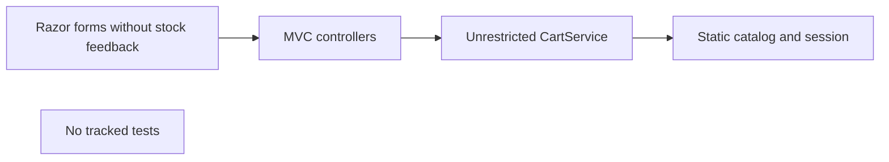
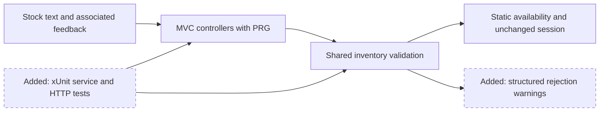
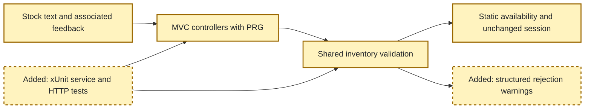

<!-- markdownlint-disable-file -->
# RPI Plan: Inventory-aware cart demo

## Task Metadata

* Task ID: inventory-aware-cart-2026-10-19
* Task slug: inventory-aware-cart
* Plan date: 2026-10-19

## Executive Summary

Add service-owned inventory limits and accessible same-page recovery to the existing MVC storefront. Preserve all current products, prices, images, session lifetime and confirmation-only checkout. Verify stock boundaries, malformed requests, logging and the full journey with focused automated tests.

### What You May Not Know

Current source has ten products, not the eight in older documentation. There are no tracked tests. .NET 6 is out of support but runtime migration is excluded. Owner Chrome/Edge and real assistive-technology review remain pending even after automated checks pass.

## Phase Checklist

### Before

### After

<!-- rpi:phase id=P01 -->
### [x] P01: Deliver and verify the local demo

Goals:
* Shoppers see stock before adding and recover from rejected mutations without losing valid cart state.

Dependencies:
* Approved local-demo PRD and completed research C1-C5, W1-W4.

<!-- rpi:task id=P01-T01 -->
#### [x] P01-T01: Enforce stock rules before session writes

Goals:
* Both mutation paths apply the same catalog-backed rule and return explicit success or actionable rejection.

Requirements:
* PRD FR-001, FR-003 through FR-007, FR-009, FR-010; NFR-001 through NFR-006.
* Fixtures include availability 0, 1, 3, 5 and 6, preserving ten existing prices and image URLs.
* Accept resulting totals equal to stock; reject above stock without writing session, including repeated adds and integer overflow attempts.
* Reject zero adds; zero updates remove only the affected line. Preserve existing negative-update removal semantics.
* Missing product returns neutral copy and a warning with `Reason=product-not-found`, `Operation`, `ProductId`, `RequestedQuantity`, and no `AvailableQuantity`. Inventory warnings contain those known fields plus availability. Never log session IDs, serialized carts, credentials or customer data.

Details:
* Add available quantity and display policy to the product model/service, outside Razor.
* Return a small typed mutation result. A shared validator uses the current catalog rather than session product copies. Calculate additive totals with `long`.
* Preserve the service's existing default single-unit add call; allow an explicit quantity.
* Model-binding failures must not turn malformed quantities into zero-removal. Missing update quantities produce explicit recovery, not success-shaped no-ops. Nonexistent cart lines return neutral recovery with a diagnostic reason.

References:
* [src/Services/CartService.cs](../../../src/Services/CartService.cs)
* [src/Services/ProductService.cs](../../../src/Services/ProductService.cs)
* [src/Models/Product.cs](../../../src/Models/Product.cs)

Dependencies:
* None.

<!-- rpi:task id=P01-T02 -->
#### [x] P01-T02: Show stock and one-time recovery on the originating page

Goals:
* Shoppers see stock text before adding and can correct rejected quantities using the keyboard.

Requirements:
* PRD FR-002, FR-007 through FR-009; NFR-007 through NFR-009; AC-002, AC-008, AC-009, AC-013.
* Labels: zero is out of stock; 1..5 show counts; above 5 shows only in-stock text. Disable zero-stock add controls.
* Add rejects return to catalog and update rejects to cart. Use PRG with one-time feedback so refresh never repeats an additive POST.
* Associate feedback with the affected quantity/action, provide announcement semantics and restore rejection focus without relying on color. Cart feedback is near the summary. Unknown product feedback receives a focusable recovery container.
* Provide labeled quantity inputs and explicit update buttons, support zero removal, preserve normal non-JavaScript form behavior, and protect modified POST actions with antiforgery.

Details:
* Keep Bootstrap/Razor presentation. Use typed service results to populate small TempData feedback fields consumed once by a shared partial; do not store raw submitted data or session/cart contents in feedback.
* A small site script restores focus to the affected input/button or fallback feedback container after rejection. Real AT speech remains owner validation.
* Keep checkout/removal semantics and 30-minute session configuration unchanged.

References:
* [src/Controllers/HomeController.cs](../../../src/Controllers/HomeController.cs)
* [src/Controllers/CartController.cs](../../../src/Controllers/CartController.cs)
* [src/Views/Home/Index.cshtml](../../../src/Views/Home/Index.cshtml)
* [src/Views/Cart/Index.cshtml](../../../src/Views/Cart/Index.cshtml)
* [src/wwwroot/js/site.js](../../../src/wwwroot/js/site.js)

Dependencies:
* P01-T01.

<!-- rpi:task id=P01-T03 -->
#### [x] P01-T03: Verify boundaries, transport and regression behavior

Goals:
* Automated evidence covers the implemented PRD and the owner has a repeatable demo and manual review checklist.

Requirements:
* PRD NFR-004 and NFR-009; AC-001 through AC-015, with owner review portions explicitly pending.
* Test ownership: new canonical xUnit project under [tests/](../../../tests/), at most five test/helper source files; exact removals: none; generated test targets: none. Test-only dependencies: xUnit, test SDK, MVC testing and NSubstitute when needed. Keep application runtime and production dependency manifest unchanged.
* Semantic tests: stock states 0/1/5/6, exact/over limits on adds/updates, repeated adds, zero paths, invalid IDs, malformed model binding, overflow, state preservation, safe warning fields and neutral copy.
* Regression tests: checkout clears cart without changing stock, removal and session isolation, all ten product prices/images, 30-minute session configuration.
* HTTP tests cover antiforgery, redirects, one-time feedback and rendered associations. Browser automation verifies rejection and keyboard focus when tools are available. No automated test claims real AT speech or owner sign-off.
* Build and test after cleaning named build outputs through `dotnet clean`; distinguish this from a genuinely clean checkout. Update the storefront README with demo fixtures, run/test commands and remaining human checks.

Details:
* Scaffold using `dotnet` tooling and add the test project to the existing solution. Use service tests plus `WebApplicationFactory` transport tests; add a public partial `Program` only as the standard test entry point.
* Use a capturing logging provider, not logger-mock verification, to assert actual warning field shapes and absence of disallowed data.
* Run the smallest relevant tests first, then solution build/test since this is a new test project. Keep .NET 6 support warnings visible.

References:
* [src/ZavaStorefront.csproj](../../../src/ZavaStorefront.csproj)
* [src/ZavaStorefront.sln](../../../src/ZavaStorefront.sln)
* [src/Program.cs](../../../src/Program.cs)
* [src/README.md](../../../src/README.md)
* [docs/prds/inventory-aware-cart.md](../../../docs/prds/inventory-aware-cart.md)

Dependencies:
* P01-T01 and P01-T02.

## User Decisions and Requirements

### Confirmed User Direction

* Build the supplied PRD for a local demo, not a production release.
* Handle the task end to end automatically.
* PRD owner-approved policies govern thresholds, copy, zero quantities and exclusions.
* No publication or tracker mutation is requested.

### Planning Decisions and Feedback

| Group | Decision | Status | Owner | Evidence and rationale | Impact |
|---|---|---|---|---|---|
| D1 | Shared service validation and PRG feedback | Resolved | Agent | Research C2-C4; rejects client-only and duplicate-post-prone rendering | P01-T01, P01-T02 |
| D2 | Preserve .NET 6 and ten products | Resolved | Agent | PRD CON-003, no migration; research C3/C5 | All tasks |
| D3 | Human Chrome/Edge and AT review | Pending execution | Owner | PRD AC-013/015 explicitly require owner review | P01-T03; no automated approval claim |

## Planning Readiness and Next Step

Complete and Ready. Initial critique Complete / Pass at the recorded hash. Agent-owned participation, standard depth. No unresolved implementation decisions. Automatic parent continues to implementation.

## Goals

Deliver GOAL-001..003 behavior; do not claim the deferred 30% to 15% business outcome.

## Scope and Non-Goals

Only storefront inventory validation, related UI, tests, README and workflow evidence. No database, reservation, decrement, payment/order system, analytics, runtime migration, external writes, commits or deployment.

## Functional Requirements

FR-001..010 retain their existing definitions in the approved PRD without renumbering or additions.

## Non-Functional Requirements

NFR-001..009 retain their existing PRD definitions. Generic framework instructions do not override the explicit no-migration boundary.

## Risks and Open Questions

* P01-T03: .NET 6 support warning is pre-existing; production migration needs a separate approved task.
* P01-T02/P01-T03: automation informs but cannot substitute owner AT/browser validation.
* P01-T03: clean output build is not identical to a clean Git checkout; report it honestly.

## Dependencies

.NET SDK and .NET 6 runtime already installed. Restore only after test-manifest creation. Browser tooling is optional evidence; owner checks remain required.

## Sources

* [docs/prds/inventory-aware-cart.md](../../../docs/prds/inventory-aware-cart.md), local-demo approved v0.2.0.
* [.copilot-tracking/research/2026-10-19/inventory-aware-cart-research.md](../../research/2026-10-19/inventory-aware-cart-research.md), C1-C5 and W1-W4; Confluence source URLs, IDs and versions retained there.

## Critique Disposition

Depth: standard, default. Attempt inventory-initial-01 reserved in this run, kind initial, status started. Projection rpi-plan-assessment-v1, SHA256 33ed772385c41259d8a23e9bbe74dc07c0d4f30f6ad19a6c4ba532e758b2d7a6. Output: `.copilot-tracking/reviews/plans/2026-10-19/inventory-aware-cart-plan-critique.md`. Generic recovery used: 0; infrastructure retries used: 0. No previous attempts or outputs. Reservation belongs to the current automatic RPI execution and will be activated immediately after readback.

Result appended: invocation completed; assessment Complete and produced; verdict Pass; no PC findings. Exact projection retained in `.copilot-tracking/reviews/plans/2026-10-19/inventory-initial-01-identity.json`. Final identity matches the assessed hash; no assessed content changed.

## Artifact Self-Check

Stable task markers, requirement IDs, dependencies, test ownership, exclusions and source pointers present. No source edits during planning.

## Follow-Up Items

Owner manual review remains required. Runtime migration and post-demo measurement are excluded from implementation.

## Handoff

Changes record: `.copilot-tracking/changes/2026-10-19/inventory-aware-cart-changes.md`.
